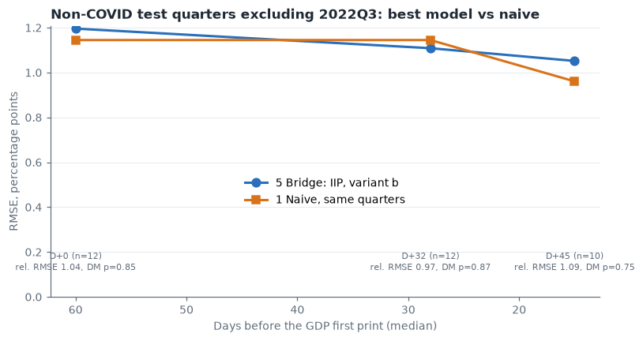

# India GDP Nowcaster

**With real-time data, simple indicators don't beat a naive rule for India's GDP first print in normal quarters. They only help in shocks.**



- **Question:** can monthly indicators such as the core 8 industries index and IIP predict India's quarterly real GDP growth before the official first estimate, and how early?
- **Data:** 34 quarterly GDP first prints, 2017Q2 to 2025Q3, read from official press notes, plus monthly indicators. Each value carries its release date, and a model may only use data released by its nowcast date.
- **Method:** a real-time backtest with an expanding window, refitted every quarter. Nowcasts are made at the end of the quarter and 32 and 45 days after it, about 61, 29 and 16 days before GDP is published. Every model is compared with a naive rule: repeat last quarter's first print.
- **Result:** outside COVID, no model beat naive. The best, an IIP bridge regression, was within noise of it at 32 days after quarter-end (RMSE 1.11 against 1.14, 12 quarters). The core 8 bridge was 20% to 30% worse than naive. In COVID quarters, the same core 8 bridge cut naive's error by 60% (RMSE 4.29 against 10.67).
- **Why it matters:** a nowcast is only worth publishing if it beats the obvious rule using data that was really available at the time. For India's recent, smooth growth path, these indicators don't, so they are best treated as shock detectors.

## What's different here

- **First prints, not revised data:** the target is the growth rate MoSPI first announced, as a real-time forecaster would face it, not today's revised series.
- **An as-of-date rule:** nothing is used before its recorded release date. Undated values aren't used, and series without release dates are labelled `[look-ahead]`.
- **The base-year break is handled, not spliced:** GDP and core 8 moved from the 2011-12 to the 2022-23 base. Models are fitted on the old base only, and the mismatch is stated wherever new-base data is used.
- **The null result is reported:** one extra model was pre-registered after the main results and reported whatever it showed. It also failed to beat naive.

## Results: non-COVID test quarters

The table shows each model's RMSE relative to naive at the D+32 nowcast date, with 2022Q3 excluded. Below 1 would mean the model beat naive.

| Model | COVID dropped from training (11 quarters) | COVID kept with a dummy (12 quarters) |
|---|---|---|
| Naive (RMSE in percentage points) | 1.05 | 1.14 |
| AR(1) | 1.13 | 1.12 |
| Bridge: core 8 | 1.20 | 1.81 |
| Bridge + AR: core 8 | 1.75 | 1.80 |
| Bridge: IIP | 1.15 (10 quarters) | 0.97 |
| Model 8: change in core 8 | 1.17 (9 quarters) | 1.61 (11 quarters) |

Model 8 was pre-registered as the only extra model before its results were seen. No Diebold-Mariano p-value is below 0.10. The lowest outside COVID, 0.10 (0.105, model 8 with the COVID dummy at D+0), favours naive, not the model. The full tables, all three dates and the COVID results are in [the report](reports/report.md).

## Live call: 2026Q3 (Jul to Sep 2026)

Pre-registered in [reports/live_nowcast_2026Q3.md](reports/live_nowcast_2026Q3.md) before the first print, due 30 Nov 2026.

| Forecast | Value | Made |
|---|---|---|
| **Primary: naive (2026Q2 first print)** | **7.8% ± 1.05** (6.75% to 8.85%) | 3 Nov 2026 |
| Bridge: core 8 | 7.0% (5.8% to 8.3%) | 3 Nov 2026 |
| Model 8: change in core 8 | 7.7% (6.6% to 8.8%) | 3 Nov 2026 |

Model 8 is almost the same as naive, so the informative comparison on 30 Nov is naive against the core 8 bridge. Every model was fitted on the 2011-12 base and applied to 2022-23 base data, so the ranges understate the uncertainty.

**Result (filled after 30 Nov 2026):** _pending_

## Repo map

```
notebooks/
  01_data.ipynb         GDP first prints from MoSPI press notes, with release dates
  02_indicators.ipynb   monthly indicators, vintages, release dates, coverage
  03_eda.ipynb          information calendar, partial-quarter signal, lead/lag
  04_models.ipynb       real-time backtest, model 8, live call
data/processed/         every table the notebooks produce (CSV)
data/raw/               download cache, not committed
reports/
  report.md, report.pdf the two-page write-up
  live_nowcast_2026Q3.md
  *.png                 charts from notebooks 01 to 04
tools/export_report_pdf.py  rebuilds report.pdf from report.md
```

## How to reproduce

Requires Python 3.12 and `curl`. Some sources reject Python's certificate store, so downloads use curl.

```bash
python -m venv .venv            # or: uv venv --python 3.12
.venv/Scripts/activate          # macOS/Linux: source .venv/bin/activate
pip install -r requirements.txt # or: uv pip install -r requirements.txt
python -m ipykernel install --user --name india-gdp-nowcaster

for nb in 01_data 02_indicators 03_eda 04_models; do
  jupyter nbconvert --to notebook --execute --inplace --ExecutePreprocessor.timeout=9000 notebooks/$nb.ipynb
done
```

Run the notebooks in order, because each reads the previous one's outputs.

- **Download time:** the first run downloads about 1,900 files (54 for notebook 01, about 1,820 for notebook 02), so notebook 02 is slow.
- **Download cache:** set `NOWCAST_RAW` to reuse an existing cache.
- **Varying results:** a run from an empty cache can return a few fewer RBI credit or UPI rows, because the Wayback Machine sometimes refuses files. Those series aren't used in notebooks 03 and 04.
- **Live file:** notebook 04 never rewrites `reports/live_nowcast_2026Q3.md` once it exists.
